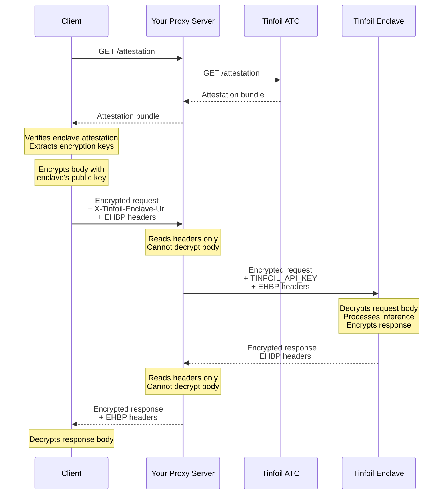

> ## Documentation Index
> Fetch the complete documentation index at: https://docs.tinfoil.sh/llms.txt
> Use this file to discover all available pages before exploring further.

# Proxy encrypted requests through your backend

> Keep your API key server-side while preserving end-to-end encryption between clients and the inference enclave.

Keep your `TINFOIL_API_KEY` on your backend. If you send it to a browser, anyone who obtains it can use your API quota. Prompts and completions should still be encrypted end-to-end to the attested enclave, not just to your backend.

A backend proxy lets you authenticate users, add your API key, track usage, and enforce rate limits without decrypting their prompts or completions. The [Encrypted HTTP Body Protocol (EHBP)](/resources/ehbp.md) encrypts request and response bodies at the application layer using [HPKE](https://datatracker.ietf.org/doc/html/rfc9180), independently of TLS. The proxy can read and modify HTTP headers but cannot decrypt the bodies. Every Tinfoil SDK automatically verifies that the HPKE key comes from an attested secure enclave.

## Client Setup

> [!NOTE]
>
> The credential passed to the client is a token for your proxy, not your backend's `TINFOIL_API_KEY`. Your proxy should authenticate the token, remove it, and add `TINFOIL_API_KEY` before forwarding the request.

JavaScript, Python, and Swift route both inference and attestation requests through your proxy when you set its URL as both the API base URL and attestation bundle URL. The SDK still verifies the attestation bundle client-side regardless of where it was fetched from.

When the SDK sends requests through a proxy (i.e., `baseURL` differs from the enclave URL), it includes the enclave URL in the `X-Tinfoil-Enclave-Url` header. Your proxy should use this header to determine where to forward requests, ensuring the encrypted payload reaches the same enclave that the client verified.

**JavaScript**

```bash theme={"dark"}
npm install tinfoil
```

```typescript theme={"dark"}
import { TinfoilAI } from "tinfoil";

const client = new TinfoilAI({
  bearerToken: "<PROXY_AUTH_TOKEN>",
  baseURL: "https://your-proxy-server.com/v1/",
  attestationBundleURL: "https://your-proxy-server.com",
});

const response = await client.chat.completions.create({
  model: "<MODEL_NAME>",
  messages: [{ role: "user", content: "Hello!" }],
});
```

**Python**

```bash theme={"dark"}
pip install tinfoil
```

```python theme={"dark"}
from tinfoil import TinfoilAI

client = TinfoilAI(
    api_key="<PROXY_AUTH_TOKEN>",
    base_url="https://your-proxy-server.com/v1/",
    attestation_bundle_url="https://your-proxy-server.com",
)

response = client.chat.completions.create(
    model="<MODEL_NAME>",
    messages=[{"role": "user", "content": "Hello!"}],
)
```

**Go**

```bash theme={"dark"}
go get github.com/tinfoilsh/tinfoil-go
```

```go theme={"dark"}
import (
    "log"

    "github.com/openai/openai-go/v3/option"
    "github.com/tinfoilsh/tinfoil-go"
)

client, err := tinfoil.NewClientWithOptions(
    tinfoil.WithBaseURL("https://your-proxy-server.com/v1/"),
    tinfoil.WithOpenAIOptions(option.WithAPIKey("<PROXY_AUTH_TOKEN>")),
)
if err != nil {
    log.Fatal(err)
}
```

Go verifies the enclave directly, then sends encrypted inference requests through the proxy. The client therefore needs network access to both the enclave and your proxy; it does not use the proxy's `/attestation` endpoint.

**Swift**

```swift theme={"dark"}
import TinfoilAI

let client = try await TinfoilAI.create(
    apiKey: "<PROXY_AUTH_TOKEN>",
    baseURL: "https://your-proxy-server.com",
    attestationBundleURL: "https://your-proxy-server.com"
)
```

**Rust**

```bash theme={"dark"}
cargo add tinfoil --git https://github.com/tinfoilsh/tinfoil-rs --tag v0.2.0
```

```rust theme={"dark"}
let client = tinfoil::Client::new_with_proxy(
    "inference.tinfoil.sh",
    "tinfoilsh/confidential-model-router",
    "<PROXY_AUTH_TOKEN>",
    "https://your-proxy-server.com",
)
.await?;
```

Rust verifies the enclave directly, then sends encrypted inference requests through the proxy. The client therefore needs network access to both the enclave and your proxy; it does not use the proxy's `/attestation` endpoint.

`baseURL` or `base_url` must point at your proxy, not a Tinfoil enclave. Include `/v1/` for JavaScript, Python, and Go. Swift and Rust append API paths themselves.

## Proxy Server Setup

Your proxy's job is to preserve the [EHBP protocol headers](/resources/ehbp.md#protocol-headers) that coordinate encryption between client and enclave, add your authentication credentials, and forward the encrypted payload. No special cryptographic libraries are needed; the proxy never participates in encryption or decryption.

While we provide an example implementation in Go below, the proxy pattern works with any language that can handle HTTP requests. The [proxy example](https://github.com/tinfoilsh/examples/tree/main/encrypted-request-proxy-example) provides a complete reference implementation with a Go proxy and a TypeScript client.

### Required Endpoints

Your proxy needs to implement these routes:

| Path | Method | Description |
| - | - | - |
| `/attestation` | GET | Proxy to `https://atc.tinfoil.sh/attestation` for JavaScript, Python, and Swift clients |
| `/v1/*` | POST | Forward API requests to the enclave URL from the `X-Tinfoil-Enclave-Url` header |

The example below forwards every `/v1/` path so chat completions, responses, embeddings, audio, and other supported APIs use the same encrypted route.

### Required Headers to Preserve

The EHBP protocol uses specific headers to coordinate encryption keys between the client and enclave.
Your proxy must forward these headers unchanged in both directions.

For requests, you need to preserve `Ehbp-Encapsulated-Key`, the HPKE encapsulated key that lets the enclave decrypt the request.
For responses, you need to preserve `Ehbp-Response-Nonce`, the nonce the client uses to derive the key that decrypts the response.

### CORS Configuration

If your proxy will be called from browser-based applications, you'll need to configure CORS headers to allow the browser to send and read the encryption headers.
The key requirement is exposing the EHBP headers in both directions:

```
Access-Control-Allow-Origin: *
Access-Control-Allow-Methods: POST, OPTIONS
Access-Control-Allow-Headers: Accept, Authorization, Content-Type, Ehbp-Encapsulated-Key, X-Tinfoil-Enclave-Url
Access-Control-Expose-Headers: Ehbp-Response-Nonce
```

### Implementation Example

```go theme={"dark"}
package main

import (
	"io"
	"log"
	"net/http"
	"net/url"
	"os"
	"strings"
)

var (
	ehbpRequestHeaders  = []string{"Ehbp-Encapsulated-Key"}
	ehbpResponseHeaders = []string{"Ehbp-Response-Nonce"}
)

func main() {
	http.HandleFunc("/v1/", proxyHandler)
	http.HandleFunc("/attestation", attestationHandler)
	log.Println("Proxy listening on :8080")
	log.Fatal(http.ListenAndServe(":8080", nil))
}

// attestationHandler proxies attestation bundle requests to the Tinfoil ATC
func attestationHandler(w http.ResponseWriter, r *http.Request) {
	w.Header().Set("Access-Control-Allow-Origin", "*")
	w.Header().Set("Access-Control-Allow-Methods", "GET, OPTIONS")
	w.Header().Set("Access-Control-Allow-Headers", "Content-Type")

	if r.Method == http.MethodOptions {
		w.WriteHeader(http.StatusNoContent)
		return
	}

	resp, err := http.Get("https://atc.tinfoil.sh/attestation")
	if err != nil {
		http.Error(w, "Failed to fetch attestation bundle", http.StatusBadGateway)
		return
	}
	defer resp.Body.Close()

	if ct := resp.Header.Get("Content-Type"); ct != "" {
		w.Header().Set("Content-Type", ct)
	}

	w.WriteHeader(resp.StatusCode)
	io.Copy(w, resp.Body)
}

// proxyHandler forwards encrypted API requests to the enclave
func proxyHandler(w http.ResponseWriter, r *http.Request) {
	// Set CORS headers
	w.Header().Set("Access-Control-Allow-Origin", "*")
	w.Header().Set("Access-Control-Allow-Methods", "POST, OPTIONS")
	w.Header().Set("Access-Control-Allow-Headers", "Accept, Authorization, Content-Type, Ehbp-Encapsulated-Key, X-Tinfoil-Enclave-Url")
	w.Header().Set("Access-Control-Expose-Headers", "Ehbp-Response-Nonce")

	if r.Method == http.MethodOptions {
		w.WriteHeader(http.StatusNoContent)
		return
	}

	// Get upstream URL from the X-Tinfoil-Enclave-Url header
	upstreamBase := r.Header.Get("X-Tinfoil-Enclave-Url")
	if upstreamBase == "" {
		http.Error(w, "X-Tinfoil-Enclave-Url header required", http.StatusBadRequest)
		return
	}
	if !isAllowedEnclave(upstreamBase) {
		http.Error(w, "Unapproved enclave URL", http.StatusBadRequest)
		return
	}
	upstreamURL := upstreamBase + r.URL.Path

	// Create upstream request
	req, err := http.NewRequestWithContext(r.Context(), http.MethodPost, upstreamURL, r.Body)
	if err != nil {
		http.Error(w, err.Error(), http.StatusInternalServerError)
		return
	}

	if contentType := r.Header.Get("Content-Type"); contentType != "" {
		req.Header.Set("Content-Type", contentType)
	}
	if accept := r.Header.Get("Accept"); accept != "" {
		req.Header.Set("Accept", accept)
	}

	// Add your API key
	apiKey := os.Getenv("TINFOIL_API_KEY")
	if apiKey == "" {
		http.Error(w, "TINFOIL_API_KEY not set", http.StatusInternalServerError)
		return
	}
	req.Header.Set("Authorization", "Bearer "+apiKey)

	// Copy encryption headers
	copyHeaders(req.Header, r.Header, ehbpRequestHeaders...)

	// Forward request
	resp, err := http.DefaultClient.Do(req)
	if err != nil {
		http.Error(w, err.Error(), http.StatusBadGateway)
		return
	}
	defer resp.Body.Close()

	// Copy encryption headers from response
	copyHeaders(w.Header(), resp.Header, ehbpResponseHeaders...)

	if ct := resp.Header.Get("Content-Type"); ct != "" {
		w.Header().Set("Content-Type", ct)
	}

	// Handle chunked transfer encoding for streaming responses
	if te := resp.Header.Get("Transfer-Encoding"); te != "" {
		w.Header().Set("Transfer-Encoding", te)
		w.Header().Del("Content-Length")
	}

	w.WriteHeader(resp.StatusCode)

	// Stream response with flushing for SSE/streaming support
	if flusher, ok := w.(http.Flusher); ok {
		buf := make([]byte, 1024)
		for {
			n, err := resp.Body.Read(buf)
			if n > 0 {
				w.Write(buf[:n])
				flusher.Flush()
			}
			if err != nil {
				break
			}
		}
		return
	}

	io.Copy(w, resp.Body)
}

func isAllowedEnclave(rawURL string) bool {
	upstream, err := url.Parse(rawURL)
	if err != nil || upstream.Scheme != "https" || upstream.User != nil {
		return false
	}
	host := upstream.Hostname()
	return host == "tinfoil.sh" || strings.HasSuffix(host, ".tinfoil.sh")
}

func copyHeaders(dst, src http.Header, keys ...string) {
	for _, key := range keys {
		if value := src.Get(key); value != "" {
			dst.Set(key, value)
		}
	}
}
```

## Usage Metrics for Billing

Since EHBP encrypts request and response bodies, your proxy cannot read token counts from the JSON. Tinfoil provides usage metrics via HTTP headers so you can track usage and bill your users.

To enable this, add the `X-Tinfoil-Request-Usage-Metrics: true` header when forwarding requests to the enclave. Tinfoil returns token counts in the `X-Tinfoil-Usage-Metrics` response header for non-streaming requests, or as an HTTP trailer after the body completes for streaming requests. The value is a comma-separated list of `key=value` pairs:

```
prompt=<prompt_tokens>,completion=<completion_tokens>,total=<total_tokens>,model=<model>,cost_usd=<cost>
```

| Field | Description |
| - | - |
| `prompt`, `completion`, `total` | Token counts for the request. Always present. |
| `cached_prompt_tokens`, `uncached_prompt_tokens` | Prompt token breakdown when the model reports prompt caching. |
| `model` | The model that served the request. |
| `web_search_calls` | Number of web searches and page fetches the model performed. Only present when at least one ran, which is also when the [web search](/guides/web-search.md) fee applies. Enabling web search without the model using it does not add this field or the fee. |
| `other_cost_usd` | Combined fees for auxiliary services, such as the [privacy filter](/guides/privacy-filter.md). Present when billable auxiliary usage is confirmed and its cost is known. |
| `cost_usd` | Total cost of the request in USD, including the web search fee when `web_search_calls` is present and `other_cost_usd` when present. Omitted if any component of the cost is unknown. |

Parse the value as a map rather than by position, since optional fields may be added between existing ones.

These headers report usage at published rates, before account-specific exemptions.

For example:

```go theme={"dark"}
// When building the upstream request:
req.Header.Set("X-Tinfoil-Request-Usage-Metrics", "true")

// After receiving the response:
// Non-streaming: read from response header
if usage := resp.Header.Get("X-Tinfoil-Usage-Metrics"); usage != "" {
    log.Printf("Usage: %s", usage)  // "prompt=67,completion=42,total=109,model=gpt-oss-120b,cost_usd=0.000042"
}

// Streaming: read from trailer after body is consumed
io.Copy(w, resp.Body)
if usage := resp.Trailer.Get("X-Tinfoil-Usage-Metrics"); usage != "" {
    log.Printf("Usage: %s", usage)
}
```

See the [proxy example](https://github.com/tinfoilsh/examples/tree/main/encrypted-request-proxy-example#usage-metrics-for-billing) for a complete implementation.

## Enforcing the Model

Because the body is encrypted, your proxy cannot see which model a request targets. If you want to allow-list models, apply per-model quotas, or bill by model, have clients send the model name in the optional `X-Tinfoil-Model` header as well:

```
X-Tinfoil-Model: <MODEL_NAME>
```

Your proxy must forward `X-Tinfoil-Model` unchanged when forwarding requests to the enclave; the check runs there, not in the proxy. Tinfoil compares the header to the `model` field in the decrypted body. If they differ, the request is rejected with a `400` error before any inference runs, so a client cannot claim one model in the header while requesting another in the body. When the header is absent, no check is performed.

The check applies to the OpenAI-compatible JSON endpoints (`/v1/chat/completions`, `/v1/responses`, `/v1/embeddings`, and similar). The header must match the body exactly, including case.

## Custom Headers

In addition to the required EHBP headers, you can send custom HTTP headers for application metadata shared between the client and proxy. EHBP encrypts bodies, not headers, so the proxy can use that metadata to authenticate users, track requests, apply rate limits, or pass feature flags. The proxy can keep these custom headers out of requests forwarded to the enclave.

### Request Headers

The JavaScript SDK's lower-level `SecureClient` lets you send arbitrary headers and inspect the raw response:

```typescript theme={"dark"}
import { SecureClient } from "tinfoil";

const secureClient = new SecureClient({
  baseURL: "https://your-proxy-server.com/",
  attestationBundleURL: "https://your-proxy-server.com",
});
await secureClient.ready();

const response = await secureClient.fetch("/v1/chat/completions", {
  method: "POST",
  headers: {
    Authorization: "Bearer <PROXY_AUTH_TOKEN>",
    "Content-Type": "application/json",
    "X-User-ID": "user-123",
    "X-Request-ID": crypto.randomUUID(),
    "Your-Custom-Request-Header": "custom-value",
  },
  body: JSON.stringify({
    model: "<MODEL_NAME>",
    messages: [{ role: "user", content: "Hello!" }],
  }),
});
```

Your proxy can then read and strip these headers for logging, routing decisions, or authentication checks before forwarding the encrypted request to the enclave:

```go theme={"dark"}
// In your proxy server
if customHeader := r.Header.Get("Your-Custom-Request-Header"); customHeader != "" {
    log.Printf("Custom request header received: %s", customHeader)
    // These headers are not forwarded to the enclave
}
```

Just remember to add any custom headers you use to your CORS `Access-Control-Allow-Headers` configuration so browsers can send them.

### Response Headers

Your proxy can add custom headers to responses that the client can read. This is useful for communicating rate limit information, cost tracking, or request IDs for debugging:

```go theme={"dark"}
// In your proxy server
w.Header().Set("Your-Custom-Response-Header", "response-value")
w.Header().Set("X-Rate-Limit-Remaining", "100")
```

The client can then access these headers:

```typescript theme={"dark"}
// Optional: Read custom headers from the response
const customHeader = response.headers.get("Your-Custom-Response-Header");
const remaining = response.headers.get("X-Rate-Limit-Remaining");
```

As with request headers, you'll need to expose custom response headers in your CORS `Access-Control-Expose-Headers` configuration for browsers to access them.

## Session Recovery

Streaming responses can take a while, and if the user closes the tab mid-stream the response is normally lost. Because your proxy already relays the encrypted stream, it can also buffer a copy. The proxy never decrypts anything; it stores the ciphertext under a session ID and serves it back later. The client keeps the key material needed to decrypt that buffer.

The client sends a session ID with the request, then exports a recovery token from the active encryption context and saves it alongside the session ID:

```typescript theme={"dark"}
import {
  SecureClient,
  serializeSessionRecoveryToken,
} from "tinfoil";

const sessionId = crypto.randomUUID();

const response = await secureClient.fetch("/v1/chat/completions", {
  method: "POST",
  headers: {
    Authorization: "Bearer <PROXY_AUTH_TOKEN>",
    "Content-Type": "application/json",
    // Application-level convention for your proxy, not part of EHBP
    "X-Session-Id": sessionId,
  },
  body: JSON.stringify({ model: "<MODEL_NAME>", messages, stream: true }),
});

// Save before reading the stream so recovery works if the tab closes mid-response
const token = await secureClient.getSessionRecoveryToken();
localStorage.setItem(
  "recovery",
  JSON.stringify({ sessionId, token: serializeSessionRecoveryToken(token) }),
);
```

When the proxy sees `X-Session-Id`, it writes the encrypted upstream response to a buffer as it forwards it. If the client disconnects, the proxy keeps the enclave connection open and continues buffering until the stream completes.

On the next page load, the client checks for a saved token, fetches the buffered ciphertext from the proxy, and decrypts it with the stored token:

```typescript theme={"dark"}
import {
  deserializeSessionRecoveryToken,
  decryptResponseWithToken,
} from "tinfoil";

const { sessionId, token } = JSON.parse(localStorage.getItem("recovery"));

const buffered = await fetch(`https://your-proxy-server.com/recovery/${sessionId}`);
const decrypted = await decryptResponseWithToken(
  buffered,
  deserializeSessionRecoveryToken(token),
);
// decrypted is a standard Response; parse it like the original stream
```

The recovery token can decrypt that one response, so treat it as sensitive and delete it (and ask the proxy to drop its buffer) once the response has been fully consumed.

See the [encrypted-session-recovery-example](https://github.com/tinfoilsh/examples/tree/main/encrypted-session-recovery-example) for a Go proxy with in-memory buffering, status and cleanup endpoints, and a browser client that resumes the stream.

## Security Considerations

While EHBP encrypts the request and response bodies, the HTTP headers remain visible throughout the proxy chain, including to your proxy.

> [!WARNING]
>
> Never expose your `TINFOIL_API_KEY` to client applications. The entire purpose of the proxy architecture is to keep this key on your backend.

* **Use HTTPS in production.** While request and response bodies are encrypted at the application layer, HTTP headers (including custom headers like user IDs) are only protected by transport-layer encryption.
* **Allowlist enclave destinations.** Treat `X-Tinfoil-Enclave-Url` as untrusted input and only forward to approved HTTPS Tinfoil enclave origins. This prevents clients from using your proxy to reach arbitrary hosts.
* **Validate and sanitize custom headers** from clients. Treat them as untrusted input: check formats, guard against injection attacks, and authenticate before trusting client-provided values.
* **Always preserve and forward the EHBP headers** (`Ehbp-Encapsulated-Key` for requests, `Ehbp-Response-Nonce` for responses). Dropping or modifying them will cause decryption to fail.

## How It Works

The data flow shows how encryption is maintained throughout the request lifecycle:



> [!NOTE]
>
> This diagram shows the proxied attestation flow used by JavaScript, Python, and Swift. Go and Rust perform attestation directly against the enclave before routing encrypted inference requests through your proxy.

## Next Steps

For a complete working example, check out the [encrypted-request-proxy-example](https://github.com/tinfoilsh/examples/tree/main/encrypted-request-proxy-example). It includes a Go proxy implementation with streaming support, a TypeScript browser client demonstrating the `SecureClient`, and custom header handling examples.

> **[Proxy Example](https://github.com/tinfoilsh/examples/tree/main/encrypted-request-proxy-example)**
>
> Go proxy server with TypeScript browser client

> **[Session Recovery Example](https://github.com/tinfoilsh/examples/tree/main/encrypted-session-recovery-example)**
>
> Resume encrypted streams after the client disconnects

> **[Encrypted HTTP Body Protocol](/resources/ehbp.md)**
>
> Deep dive into the EHBP specification


This documentation is built and hosted on [Mintlify](https://mintlify.com), a developer documentation platform.