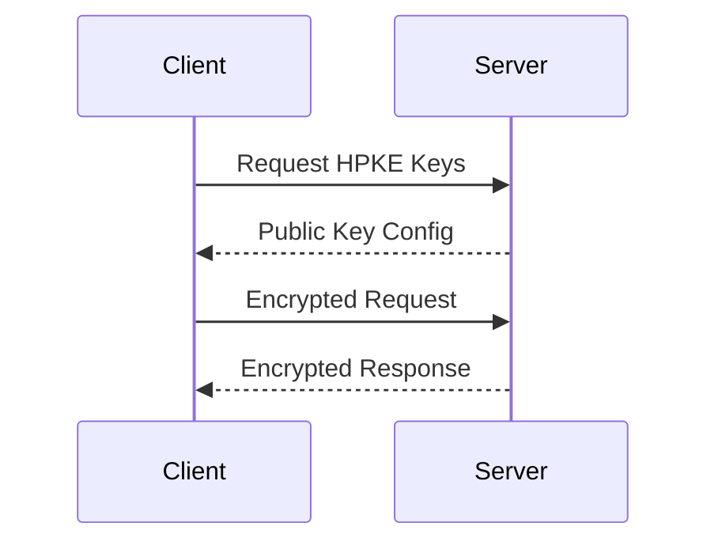

> ## Documentation Index
> Fetch the complete documentation index at: https://docs.tinfoil.sh/llms.txt
> Use this file to discover all available pages before exploring further.

# Encrypted HTTP Body Protocol

> Understanding EHBP: the protocol that encrypts HTTP bodies end-to-end while preserving routing metadata.

> **[GitHub Repository](https://github.com/tinfoilsh/encrypted-http-body-protocol)**
>
> Reference implementation with Go server middleware, Go client transport, and JavaScript client
> [](https://github.com/tinfoilsh/encrypted-http-body-protocol/actions)

## Overview

EHBP (Encrypted HTTP Body Protocol) is a protocol that encrypts HTTP message bodies end-to-end while leaving HTTP headers in the clear for routing. This allows encrypted payloads to transit proxies unchanged while maintaining all standard HTTP semantics.

The protocol uses [HPKE (RFC 9180)](https://datatracker.ietf.org/doc/html/rfc9180) for hybrid public key encryption, ensuring that only the intended recipient can decrypt the message body.

## How It Works

### Architecture

EHBP is implemented as two complementary components:

1. **Client Transport**: Encrypts outgoing request bodies and decrypts incoming response bodies
2. **Server Middleware**: Decrypts incoming request bodies and encrypts outgoing response bodies

### Message Flow

For each HTTP exchange:



### Encryption Process

**Request Encryption:**

1. Client fetches server's public key from `/.well-known/hpke-keys`
2. Client establishes an HPKE encryption context to the server's public key
3. Client encrypts request body as a stream of length-prefixed chunks
4. Client includes the HPKE encapsulated key in the `Ehbp-Encapsulated-Key` header

**Response Encryption:**

1. Server decrypts request using the encapsulated key, establishing an HPKE context
2. Server exports a secret from the HPKE context using the label `"ehbp response"`
3. Server generates a random 32-byte nonce and derives response encryption keys via HKDF using `salt = concat(encapsulated_key, response_nonce)`
4. Server encrypts response body with AES-256-GCM using the derived keys
5. Server includes the nonce in the `Ehbp-Response-Nonce` header so the client can derive the same decryption keys

> [!NOTE]
>
> **Bodyless requests**: Requests without a body (GET, HEAD, DELETE, OPTIONS) cannot have encrypted responses. The encrypted request body provides implicit authentication of the encapsulated key. Without it, a man-in-the-middle could substitute their own key. Applications requiring encrypted responses to bodyless requests should include a minimal body.

### Body Framing

Encrypted bodies are framed as a sequence of chunks:

```
[LENGTH (4 bytes, big-endian uint32)] [CIPHERTEXT (LENGTH bytes)]
[LENGTH (4 bytes, big-endian uint32)] [CIPHERTEXT (LENGTH bytes)]
...
```

* Each chunk has a 4-byte big-endian unsigned integer length prefix
* Length counts ciphertext bytes only (not the 4-byte header)
* Each chunk is encrypted with AES-256-GCM
* A chunk with length 0 may appear (empty write) and should be skipped by receivers
* End of message is indicated by HTTP stream termination (no sentinel chunk)

## Protocol Headers

| Header | Direction | Description |
| - | - | - |
| `Ehbp-Encapsulated-Key` | Request | HPKE encapsulated key (lowercase hex, 64 characters for X25519). Required when request has an encrypted body. |
| `Ehbp-Response-Nonce` | Response | Random 32-byte nonce (lowercase hex, 64 characters). Required for encrypted responses. Used to derive decryption keys. |

## Implementation Examples

The EHBP reference implementation provides ready-to-use components for both Go and JavaScript. These examples show how to add encrypted body support to an existing HTTP server or client.

### Go Server Middleware

```go theme={"dark"}
package main

import (
  "log"
  "net/http"

  "github.com/tinfoilsh/encrypted-http-body-protocol/identity"
  "github.com/tinfoilsh/encrypted-http-body-protocol/protocol"
)

func main() {
  // Load or create server identity
  id, err := identity.FromFile("server_identity.json")
  if err != nil {
    log.Fatalf("server exited: %v", err)
  }

  mux := http.NewServeMux()

  // Serve HPKE public key configuration
  mux.HandleFunc(protocol.KeysPath, id.ConfigHandler)

  // Wrap handler with EHBP middleware
  mux.Handle("/secure", id.Middleware(false)(http.HandlerFunc(func(w http.ResponseWriter, r *http.Request) {
    // Body is automatically decrypted
    // Response will be automatically encrypted
    w.Write([]byte("ok"))
  })))

  log.Println("Server listening on :8080")
  http.ListenAndServe(":8080", mux)
}
```

### Go Client Transport

```go theme={"dark"}
package main

import (
  "bytes"
  "io"
  "log"
  "net/http"

  "github.com/tinfoilsh/encrypted-http-body-protocol/client"
)

func main() {
  // Create EHBP transport (fetches server public key automatically)
  tr, err := client.NewTransport("http://localhost:8080", false)
  if err != nil {
    log.Fatalf("failed to create transport: %v", err)
  }

  // Use with standard HTTP client
  httpClient := &http.Client{Transport: tr}

  resp, err := httpClient.Post(
    "http://localhost:8080/secure",
    "text/plain",
    bytes.NewBufferString("sensitive data"),
  )
  if err != nil {
    log.Fatalf("request failed: %v", err)
  }
  defer resp.Body.Close()

  body, _ := io.ReadAll(resp.Body)
  log.Printf("Response: %s", body)
}
```

### JavaScript/TypeScript Client

```typescript theme={"dark"}
import { createTransport } from 'ehbp';

async function main() {
  // Create EHBP transport (fetches server public key automatically)
  const transport = await createTransport('http://localhost:8080');

  // Make encrypted request
  const response = await transport.post('/secure', JSON.stringify({ message: 'sensitive data' }), {
    headers: { 'Content-Type': 'application/json' }
  });

  const data = await response.text();
  console.log('Response:', data);
}
```

## Key Distribution

### Server Public Key Discovery

Servers **must** expose their HPKE configuration at:

```
/.well-known/hpke-keys
```

**Response format:**

* Content-Type: `application/ohttp-keys`
* Body: Key configuration as defined in [RFC 9458 Section 3](https://datatracker.ietf.org/doc/html/rfc9458#section-3)

**Key configuration includes:**

* `key_id`: 0
* `kem_id`: X25519\_HKDF\_SHA256
* `cipher_suites`: HKDF\_SHA256 with AES\_256\_GCM
* `public_key`: Server's KEM public key bytes

### Server Identity Management

Servers need a persistent identity (keypair) for EHBP. Clients do not need their own identity; they only need to fetch the server's public key.

```go theme={"dark"}
// Generate new identity (writes to file if not exists)
id, err := identity.FromFile("server_identity.json")

// Or create ephemeral identity
id, err := identity.NewIdentity()
```

## CLI Tools

The EHBP repository includes command-line tools for testing and development.

### Example Server

```bash theme={"dark"}
# Run example server (creates identity if needed)
go run ./cmd/example/server -l :8080 -i server_identity.json -v
```

### Example Client

```bash theme={"dark"}
# Run example client
go run ./cmd/example/client -s http://localhost:8080 -v
```

### Fetch Tool

curl-like tool that sends encrypted requests:

```bash theme={"dark"}
# POST encrypted data
go run ./cmd/fetch -X POST -d 'hello' http://localhost:8080/secure

# GET request (no encrypted response possible without request body)
go run ./cmd/fetch http://localhost:8080/secure
```

## Use in Tinfoil JavaScript SDK

The Tinfoil JavaScript SDK uses EHBP to encrypt all request and response bodies to the inference enclaves. This is particularly important for browser environments where TLS certificate pinning is not available.

Since browsers don't support certificate pinning, EHBP provides an alternative: the SDK fetches the enclave's attested HPKE public key and encrypts all request bodies directly to that verified key. This ensures your prompts and completions are encrypted end-to-end to the verified enclave.

### EHBP in Action

You can see EHBP in action by visiting [chat.tinfoil.sh](https://chat.tinfoil.sh/) and inspecting the network tab. The request payload shows encrypted content that only the attested enclave can decrypt:


This documentation is built and hosted on [Mintlify](https://mintlify.com), a developer documentation platform.